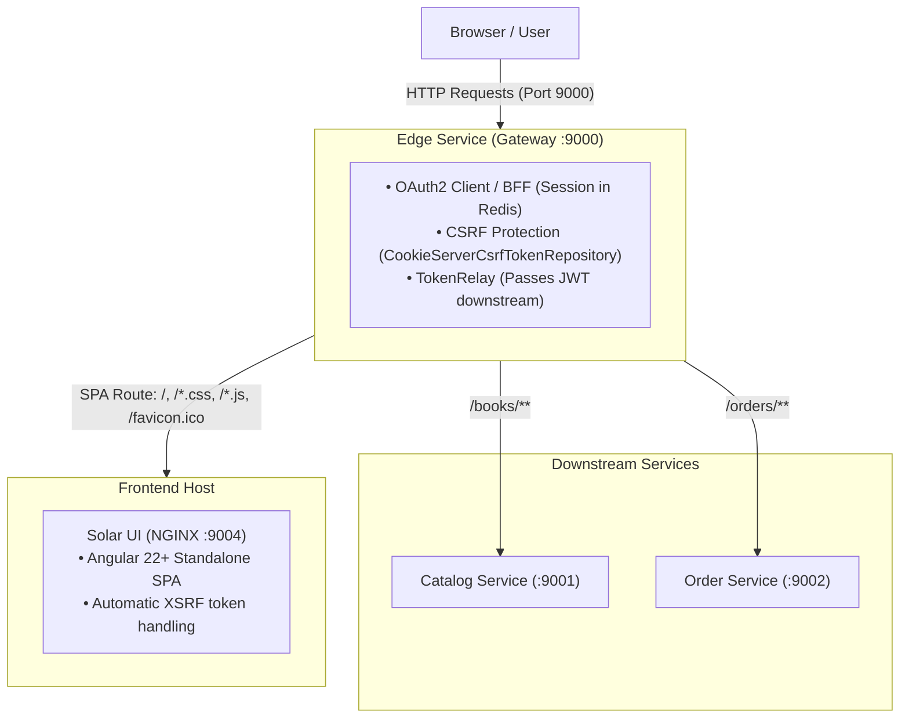
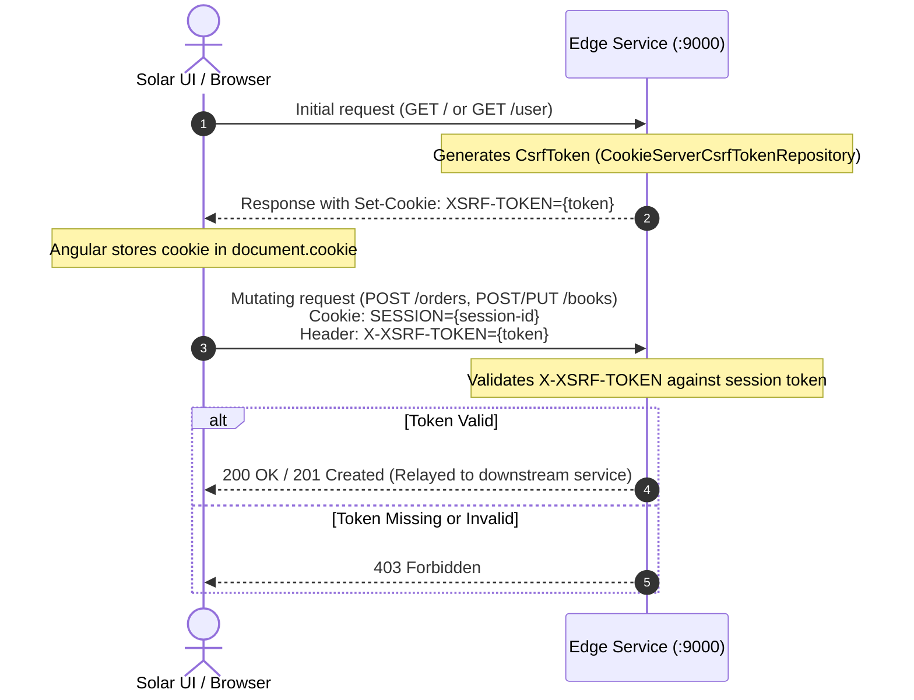

# SolarUI

## Architecture & Edge Service Integration

Solar UI is a standalone Angular Single Page Application (SPA) designed to work behind **Edge Service** (Spring Cloud Gateway) following the **Backend-for-Frontend (BFF)** pattern:



- **SPA Serving**: In production/Docker, `edge-service` routes requests for static assets (`/`, `/*.css`, `/*.js`, `/favicon.ico`) to the NGINX container hosting Solar UI (`:9004`).
- **Relative API Calls**: Solar UI makes relative HTTP requests to `/books`, `/orders`, and `/user`. The browser sends them to `edge-service` (`:9000`), which manages sessions, security tokens, and routing.

---

## HTTP Communication & Security (CSRF / XSRF Protection)

Because user authentication is maintained via session cookies (`SESSION`) between the browser and `edge-service`, the application enforces **Cross-Site Request Forgery (CSRF/XSRF)** protection for all state-mutating HTTP methods (`POST`, `PUT`, `DELETE`).

### How It Works (End-to-End Flow)



### 1. Edge Service Configuration (Backend)

In `edge-service/src/main/java/com/solarbookshop/edgeservice/config/SecurityConfig.java`:

- **Token Repository**:
  ```java
  .csrf(csrfSpec -> csrfSpec
      .csrfTokenRepository(CookieServerCsrfTokenRepository.withHttpOnlyFalse())
      .csrfTokenRequestHandler(new ServerCsrfTokenRequestAttributeHandler()))
  ```
  `CookieServerCsrfTokenRepository.withHttpOnlyFalse()` writes the CSRF token into an HTTP cookie named `XSRF-TOKEN`. The `withHttpOnlyFalse()` setting is essential because it allows JavaScript (Angular) to read the cookie value.
- **WebFilter Workaround**:
  A custom `WebFilter` bean explicitly subscribes to the reactive `CsrfToken` publisher before the response commits, ensuring the `Set-Cookie` header is always emitted on requests.

### 2. Angular Configuration (Frontend)

In `solar-ui/src/app/app.config.ts`:

```typescript
export const appConfig: ApplicationConfig = {
  providers: [
    provideBrowserGlobalErrorListeners(),
    provideRouter(routes, withComponentInputBinding()),
    provideHttpClient(withXsrfConfiguration({
      cookieName: 'XSRF-TOKEN',
      headerName: 'X-XSRF-TOKEN',
    }))
  ]
};
```

- **`withXsrfConfiguration`**: Configures Angular's built-in `HttpClientXsrfModule`:
  - `cookieName: 'XSRF-TOKEN'`: Directs Angular to read the CSRF token from the cookie set by `edge-service`.
  - `headerName: 'X-XSRF-TOKEN'`: Directs Angular to automatically inject this token into the `X-XSRF-TOKEN` header on all mutating requests (`POST`, `PUT`, `DELETE`, `PATCH`).
- **`AuthService`**:
  [`AuthService`](src/app/services/auth-service.ts) injects `HttpXsrfTokenExtractor` via `getCsrfToken()` to retrieve the raw token when needed (e.g. for custom submissions or logout workflows).

---

## Commands

### Build Angular assets

Build the production Angular assets used by the container or CI.

```shell
./gradlew buildAngular
```

### Build image with Paketo / pack

Build an NGINX container using the Pack CLI and Paketo buildpacks.

```shell
pack build solar-ui \
  --buildpack paketo-buildpacks/nginx \
  --builder paketobuildpacks/ubuntu-resolute-builder:latest \
  --path dist \
  --pull-policy if-not-present
```

### Run image produced by pack

Run the image produced by the `pack build` step.

```shell
docker run -d --rm --name solar-ui --publish 9004:9004 --env PORT=9004 solar-ui
```
